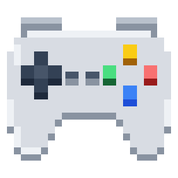
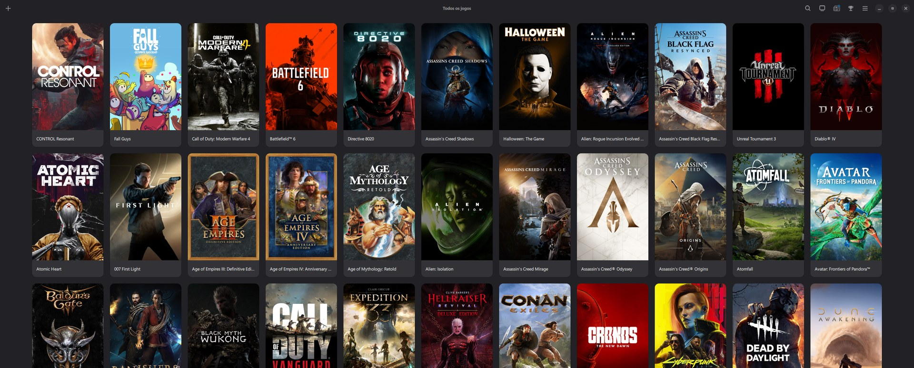
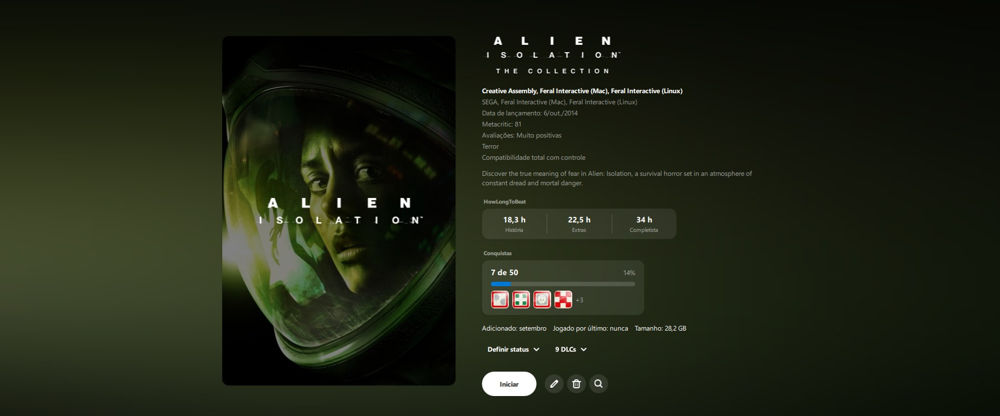
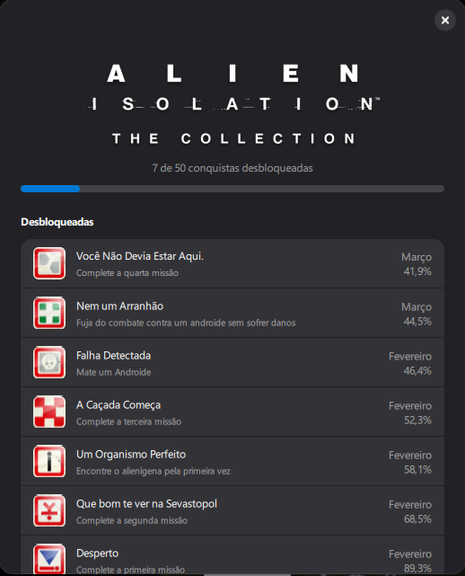
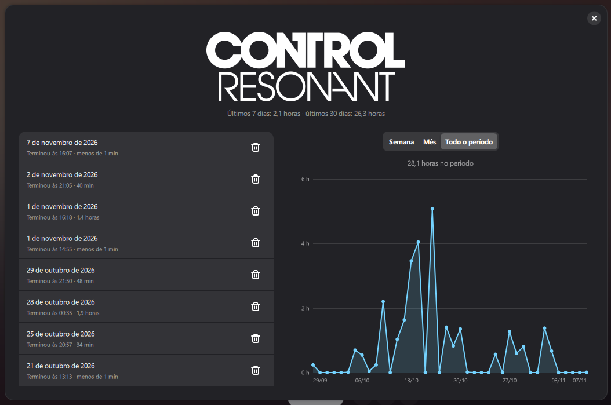
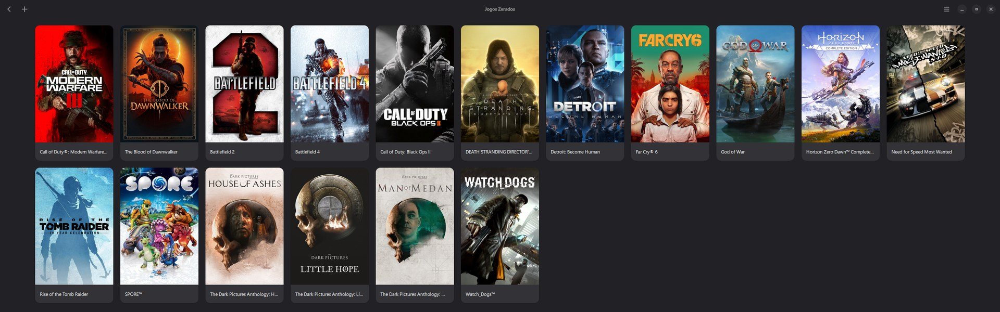
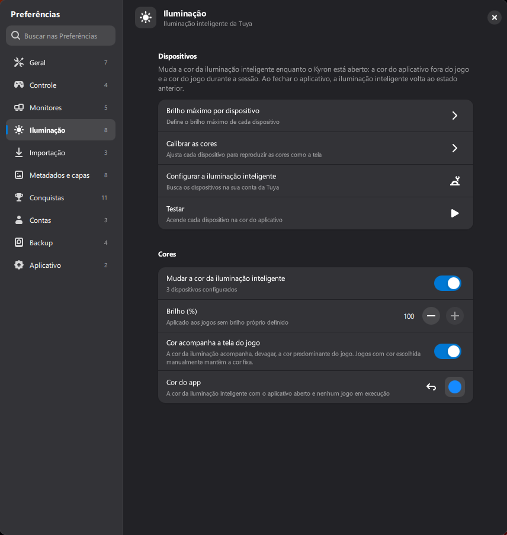

<div align="center">
  

  # Kyron

  Todos os jogos do seu PC em um só lugar.

  [**Baixar para Windows**](https://github.com/joaomgabaldi/Cartridges/releases/latest)
</div>

O Kyron reúne os jogos do seu PC, venham de onde vierem (Steam, Epic, Ubisoft Connect, EA app, Xbox e Game
Pass, ou um executável qualquer), numa biblioteca única com capas, metadados, tempo de jogo, conquistas e
backup dos saves. A interface é em português do Brasil.



## Recursos

### Biblioteca

- Importa uma pasta de atalhos (`.lnk`, `.url` e aplicativos da Microsoft Store e do Game Pass), ao abrir o
  aplicativo ou ao arrastar atalhos para a janela. Jogos desinstalados podem ser removidos da biblioteca automaticamente.
- Um jogo continua reconhecido quando o atalho muda (atualização, pasta movida, executável trocado), sem
  perder tempo de jogo, capa nem histórico.
- Busca, ordenação (título, data de adição, jogados recentemente, mais jogados, lançamento, nota e tamanho
  no disco) e filtros por gênero, ano e status.
- Capas animadas ao passar o mouse ou o tempo todo.
- **Big Picture**: biblioteca em tela cheia para jogar do sofá, com navegação completa pelo controle Xbox.

### Página do jogo

- Capa, logo, fundo desfocado, metadados da Steam (desenvolvedora, lançamento, gênero, descrição,
  avaliações e Metacritic) e os tempos do [HowLongToBeat](https://howlongtobeat.com).
- Capas, capas animadas e logos do [SteamGridDB](https://www.steamgriddb.com), ou de um arquivo do
  computador. Um vídeo vira capa animada.
- Status ("Quero jogar", "Jogando", "Zerado" ou "Abandonado"), nota de uma a cinco estrelas e uma anotação
  livre "Onde eu parei".



### Conquistas

- Acompanha as conquistas da Steam, Epic Games, Ubisoft Connect, Xbox (incluindo o Game Pass) e EA app
  enquanto você joga.
- Quando a loja não mostra o próprio aviso, o Kyron mostra um no canto da tela, com som.
- A janela de conquistas mostra o progresso, a data de cada desbloqueio e a porcentagem de jogadores que
  também a têm.

<p align="center"></p>

### Tempo de jogo

- O tempo de jogo é contado automaticamente, observando o processo do jogo, inclusive em jogos com lançador separado.
- Cada sessão fica registrada, com um gráfico de horas por dia e o total dos últimos 7 e 30 dias.
- O PC suspenso com o jogo aberto não conta como tempo de jogo.



### Jogos Zerados

Os jogos zerados continuam no aplicativo depois de desinstalados, com capa, nota e histórico de sessões.
Quando o jogo é reinstalado, as informações e o histórico são reunidos novamente.



### Durante a sessão

- **Outro monitor**: ao iniciar um jogo, a janela do Kyron pode ser movida para outro monitor, com o logo do jogo, o tempo da
  sessão e as conquistas.
- **Papel de parede**: os outros monitores podem exibir a arte do jogo, buscada no
  [wallhaven](https://wallhaven.cc), e voltam ao papel de parede de antes no fim da sessão.
- **Iluminação inteligente**: fitas de LED e lâmpadas da Tuya ficam na cor do jogo durante a sessão, ou
  acompanham a cor da tela. Um assistente calibra as cores de cada dispositivo.

<p align="center"></p>

### Backup e atualizações

- Ao fim de cada sessão, o Kyron faz o backup dos saves do jogo, com as 5 versões mais recentes, numa pasta
  que pode ficar no OneDrive.
- Um backup `.zip` leva a biblioteca inteira, as configurações e os saves.
- O aplicativo se atualiza sozinho, com a sua confirmação, e mostra o que mudou em cada versão.

## Instalação

Baixe o `Kyron.Windows.exe` da [versão mais recente](https://github.com/joaomgabaldi/Cartridges/releases/latest)
e execute. O instalador pede permissão de administrador e instala para todos os usuários. Ao desinstalar, ele
pergunta se deve remover também a biblioteca e as configurações.

Requer o Windows 10 (versão 1809 ou mais recente) ou o Windows 11, de 64 bits.

## Compilação

O aplicativo é escrito em Python 3.15 com PySide6 6.12.0 (Qt Quick). A janela sem moldura usa o
[QWindowKit](https://github.com/stdware/qwindowkit), compilado numa DLL pequena
(`kyron/janela/qwk_ponte.dll`) que o repositório não guarda. Os comandos abaixo rodam no
PowerShell, a partir da raiz do projeto.

### Executar do código-fonte

1. Instale o Python 3.15 e crie o ambiente com as dependências fixadas
   (`requirements.txt`, mais o `pytest` e o `py7zr` do `requirements-dev.txt`):

   ```powershell
   powershell -NoProfile -ExecutionPolicy Bypass -File tools\ambiente_qt.ps1
   ```

2. Gere a `qwk_ponte.dll`. É preciso o Git, o Visual Studio 2022 (ou só as Build Tools) com o conjunto de
   ferramentas MSVC 14.44, o CMake e o Ninja. O primeiro comando baixa o SDK do Qt 6.12.0 e o
   QWindowKit para `build-aux\windows\qwk\_deps`; o segundo compila a DLL:

   ```powershell
   .venv\Scripts\python tools\baixar_qt_sdk.py
   build-aux\windows\qwk\compilar.bat
   ```

3. Abra o aplicativo:

   ```powershell
   .venv\Scripts\python -m kyron
   ```

Executado a partir do código-fonte, o aplicativo usa o canal de desenvolvimento: os dados ficam em
`%LOCALAPPDATA%\io.github.joaomgabaldi.Cartridges-dev` e nas preferências
`Cartridges-dev` do registro, nunca nos da versão instalada (os nomes internos continuam os do
Cartridges, que deu origem ao Kyron). Para começar com uma cópia da sua biblioteca, rode
`.venv\Scripts\python tools\copiar_dados_dev.py`.

O `ffmpeg` converte o vídeo escolhido como capa animada e o Ludusavi faz o backup dos saves; o
instalador leva os dois. Executado a partir do código-fonte, o aplicativo procura o `ffmpeg` no
`PATH`, mas o Ludusavi só ao lado do Python (`.venv\Scripts\ludusavi.exe`); sem ele, o backup dos
saves fica indisponível. Para usá-lo, copie para essa pasta o `ludusavi.exe` que o instalador leva
(baixado em `_dist\cache-qt\ludusavi` na primeira montagem do instalador).

### Instalador

O instalador oficial é gerado pelo workflow **Gerar instalador (beta)** do GitHub Actions
(`.github/workflows/instalador.yml`), disparado à mão. Ele baixa o Python embutido, o `ffmpeg` e o
Ludusavi (conferidos por SHA-256), compila a `qwk_ponte.dll`, monta a pasta do aplicativo com
`build-aux/windows/montar_app_qt.py`, empacota com o [Inno Setup 7](https://jrsoftware.org/isinfo.php)
(o 6 não serve) e publica uma pré-release. Depois de testada, a pré-release é promovida a versão final.

Para gerar um instalador local de teste, execute `build-installer.bat` e escolha a opção 2. Ele
monta a pasta do aplicativo no canal final, empacota com o Inno Setup e grava o instalador em
`_dist\instalador`. Precisa da `qwk_ponte.dll` do passo anterior, do Inno Setup 7 e de internet na
primeira vez (para baixar o Python embutido, o `ffmpeg` e o Ludusavi). A opção 1 dispara o workflow
no GitHub: não a use para um teste local.

### Testes

```powershell
.venv\Scripts\python -m pytest
```

Os testes usam pastas e chaves de registro temporárias; nenhum toca nos dados do aplicativo.

## Histórico de versões

As mudanças de cada versão aparecem no aplicativo, em *Sobre o Kyron → Novidades*, e estão em
[`data/io.github.joaomgabaldi.Cartridges.metainfo.xml.in`](data/io.github.joaomgabaldi.Cartridges.metainfo.xml.in).

## Créditos e licença

O Kyron nasceu como um fork do [Cartridges](https://codeberg.org/kramo/cartridges), criado por kramo e
pelos colaboradores do projeto original. É mantido por joaomgabaldi e distribuído sob a licença
[GPL-3.0-or-later](LICENSE).
